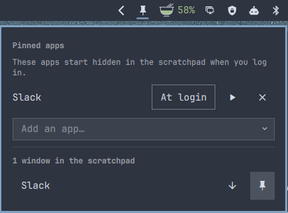

# Scratchpad Pinned

An [Omarchy](https://omarchy.org) shell plugin that pins apps to the Hyprland
scratchpad (`Super + S`).

- **At login**: a pinned app starts hidden in the scratchpad when you log in,
  then opens normally if you close it and start it again later.
- **Always**: whenever the app opens its main window, it goes to the
  scratchpad. Its dialogs and call windows open as usual.


- **Bar icon**: a filled pin while windows wait in the scratchpad (outlined
  and dimmed when it is empty), so an app hidden there never looks like it
  "won't open". Hover for the count.

## Install

```bash
omarchy plugin add https://github.com/yoann54/scratchpad-pinned.git --enable
```

### Requirements

Omarchy with its shell plugins (Quickshell) and Hyprland 0.56 or newer, which
takes Lua dispatchers. The plugin also calls `inotifywait` (inotify-tools) and
`notify-send` (libnotify); both ship with Omarchy. It needs no network access
and no privileges.

## Uninstall

```bash
omarchy plugin remove io.github.yoann54.scratchpad-pinned
rm -r ~/.config/scratchpad-pinned   # optional: the list of pinned apps
```

Pinned apps stop being launched at login as soon as the plugin is removed.
The plugin writes nothing else: no Hyprland config, no other Omarchy file.
`apps.json` is readable by you only (`0600`, in a `0700` directory): an app
pinned without a desktop entry is saved with the command line it was started
with, arguments included.
Windows already in the scratchpad stay there; `Super + S` still shows them.

## Use

| Action | How |
| --- | --- |
| Show or hide the scratchpad | Left-click the icon (or `Super + S`) |
| Pin any installed app | Right-click the icon, then *Add an app…*: search the launcher's apps (open ones first) |
| Pin the focused window's app | Middle-click the icon, or `omarchy-shell scratchpad-pinned pin` |
| Pin an app already in the scratchpad | Right-click the icon, then the pin next to its window |
| Manage pinned apps | Right-click the icon: switch *At login* / *Always*, launch now, unpin |
| Jump to a window in the scratchpad | Right-click the icon, then click the window |
| Take a window out of the scratchpad | Right-click the icon, then the arrow next to the window: it comes to the current workspace |

Pinning a window (middle-click or `pin`) also sends it to the scratchpad straight away. Pinning from *Add an app…* leaves open windows where they are.

### Keybinding

Add to `~/.config/hypr/bindings.lua`:

```lua
o.bind("SUPER + ALT + P", "Pin app to scratchpad", "omarchy-shell scratchpad-pinned togglePin")
o.bind("SUPER + ALT + M", "Scratchpad menu", "omarchy-shell shell toggle io.github.yoann54.scratchpad-pinned")
```

The menu works from the keyboard: Tab to *Add an app…*, Space to open it,
type to filter, arrows and Enter to pick, Escape to close.

### IPC

`omarchy-shell scratchpad-pinned <method>`:

| Method | Does |
| --- | --- |
| `pin` | Pin the focused window's app (at login) |
| `pinAlways` | Pin the focused window's app (always) |
| `unpin` | Unpin the focused window's app |
| `togglePin` | Pin or unpin the focused window's app |
| `toggle` | Show or hide the scratchpad |
| `pinApp <desktopId>` | Pin an installed app by desktop entry id (e.g. `slack`) |
| `pinnable` | List the installed apps that can be pinned, as JSON |
| `launch <appId>` | Start a pinned app into the scratchpad now |
| `bring <address>` | Move a window out of the scratchpad to the current workspace |
| `startAll` | Start every pinned app as at login |
| `list` | Print the pinned apps as JSON |
| `count` | Number of windows in the scratchpad |

## Configuration

Pinned apps live in `~/.config/scratchpad-pinned/apps.json`. You can edit it by
hand; the plugin picks changes up within a few seconds.

```json
{
  "apps": [
    {
      "appId": "Slack",
      "name": "Slack",
      "desktopId": "slack",
      "command": ["/usr/bin/slack"],
      "mode": "startup"
    }
  ]
}
```

- `appId` is the window class (`hyprctl clients | grep class`).
- `command` is how to start it. When you pin a window, it comes from the app's
  desktop entry, or from the window's process command line when there is none.
- `mode` is `startup` (at login) or `always`.

The bar widget has one setting, *Hide when empty*.

## How it works

- At login the apps are started with a one-shot Hyprland exec rule
  (`workspace special:scratchpad silent`), so they never flash on screen.
  An app that is already running is hidden instead of started twice.
- Apps that hand their window to another process (Electron, terminal
  servers) escape that rule. For a minute after a launch, the app's first
  window is moved to the scratchpad instead. Only the first one, so a call
  or dialog opening right after login stays visible.
- An app pinned from *Add an app…* is matched to its windows by the class
  its desktop entry declares. When the real class differs, the plugin learns
  it from the first window it launches and saves it.
- A marker in `$XDG_RUNTIME_DIR` remembers that this Hyprland session has
  been started, so restarting the shell or reloading the plugin does not
  launch the apps again.
- In *Always* mode, a new window is hidden only when the app has no other
  window open: that is its main window, not a dialog or a call.
- The config directory is watched with `inotifywait`, so hand edits apply at
  once, editors that replace the file included.
- The menu is built the first time it opens, not at startup on every
  monitor.

## Development

```bash
git clone https://github.com/yoann54/scratchpad-pinned.git ~/Work/scratchpad-pinned
cd ~/Work/scratchpad-pinned
node tests/model.test.js
tests/integration.sh   # needs the plugin running; opens a few short-lived foot windows
omarchy plugin validate .

# Install a copy (Quickshell does not reload QML reached through a symlink)
rsync -a --exclude .git --exclude tests ./ ~/.config/omarchy/plugins/io.github.yoann54.scratchpad-pinned/
omarchy-shell shell rescanPlugins
omarchy plugin enable io.github.yoann54.scratchpad-pinned --section right
```

After a change, run the `rsync` again. A plugin hot reload keeps the previous
IPC handler registered, so restart the shell (`omarchy restart shell`) when
you change the IPC methods.

## License

MIT
